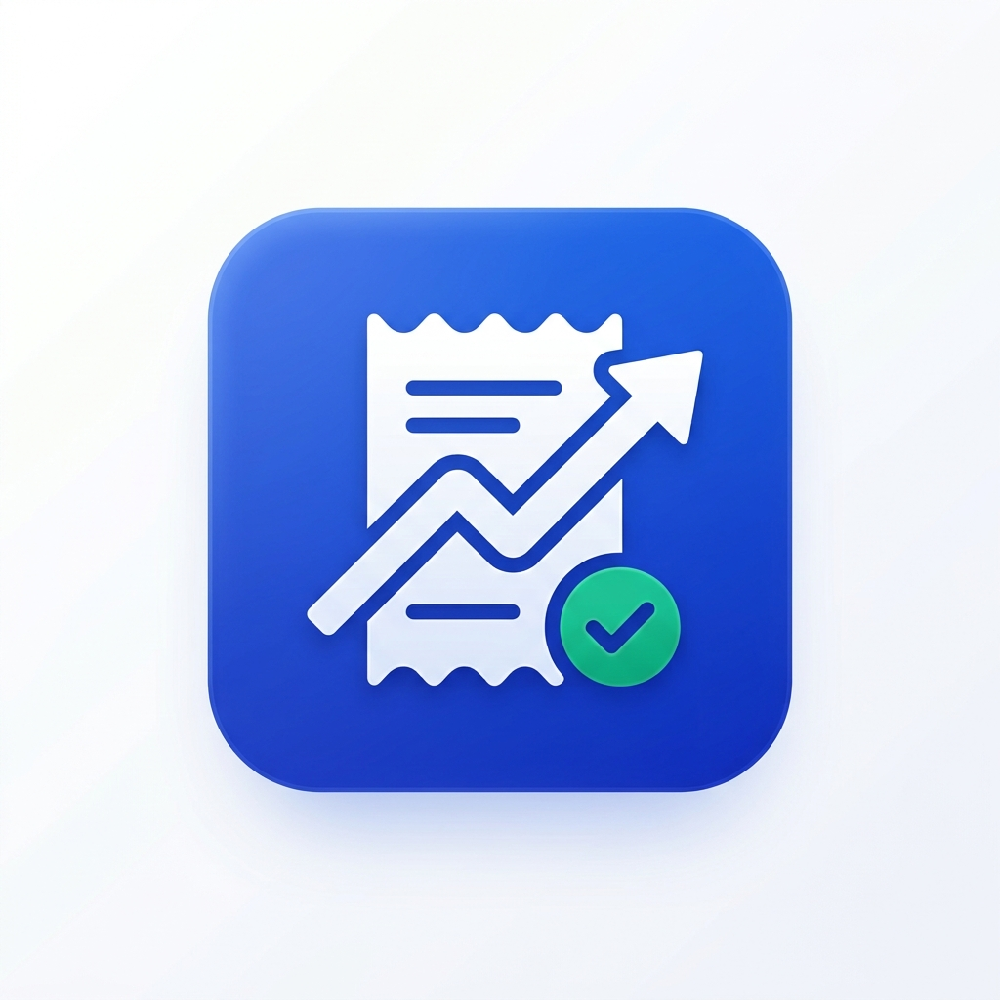

# 📊 Testing Sales App - Complete GST Billing, Mobile POS, Inventory & Accounting Suite

<p align="center">
  
  <br/>
  <strong>Testing Sales App</strong>
  <br/>
  <em>Offline-First • Multi-Device • Web Application • Windows Desktop • Android Mobile</em>
</p>

An offline-first, high-performance GST billing, inventory management, point-of-sale (POS), and business accounting application designed for Indian small & medium businesses (SMBs), retailers, wholesalers, and distributors.

### 🌐 Platforms Supported:
- **Web Application:** Run directly in any modern web browser (Chrome, Edge, Safari, Firefox) via WebAssembly SQLite & IndexedDB: **[Launch Live Webapp](https://Infosparkinn.github.io/new-sales-app/app/)**
- **Windows Desktop:** High-performance native x64 desktop software with SQLite FFI runtime (`testing_sales_app_windows.zip`).
- **Android Mobile:** Standalone offline APK for retail counters and handheld field staff (`testing_sales_app.apk`).

---

## 🌟 Complete Feature Breakdown (Based on Vyapar Blueprint)

### 🏢 1. Menu & Navigation Drawer
- **Sale Module:** Sale Invoices, Payment In, Sale Return (Credit Note), Estimate / Quotation, Proforma Invoice, Sale Order, Delivery Challan, Mobile POS.
- **Purchase Module:** Purchase Bills, Payment Out, Purchase Return (Debit Note), Purchase Orders.
- **Expenses:** Preset categories for Manufacturing Expenses, Petrol, Rent, Salary, Tea, Transport, and Utilities with Input Tax Credit (ITC) eligibility.
- **Cash and Bank:** Bank Accounts, Cash in Hand, Cash in GPay / UPI, Credit Card accounts, and inter-account fund transfers.
- **My Online Store:** Digital product catalog with WhatsApp shareable links and UPI payment integration.
- **Customer Loyalty Points:** Reward program with configurable earn rates (e.g. 1 pt per ₹100), redemption on bills, and customer points ledgers.
- **Loans & Liabilities:** Business loans, EMIs, interest rates, and loan statement repayment logs.
- **Sync Company:** Cross-device multi-company sync (integrated with **Sivan sports pro**).
- **Backup & Restore:** Auto Backup, Backup to phone (.json), Backup to e-mail, and one-click database restore.
- **Utilities:**
  - Verify My Data (Database integrity & balance sheet reconciliation check)
  - Open Calculator (Quick billing calculator with +5%, +12%, +18%, +28% GST buttons)
  - Import Items (CSV / Excel format)
  - Import from MyBillBook (MyBillBook migration parser)
  - Bulk Update Tax Slab (Batch update GST rates across items)
  - Export Items (CSV inventory export)
  - Import Parties (CSV customers/suppliers import)
  - Recycle Bin (Soft-delete & recovery for invoices and transactions)
  - Close Financial Year (Roll forward closing balances to new FY)
  - Messages (WhatsApp / SMS alert logs and customer broadcasts)

---

### 📑 2. Comprehensive 7-Category Reports Hub (40+ Reports)

#### Category 1: Financial & Transaction Reports
- **Sale Report:** Detailed sales turnover and collections.
- **Purchase Report:** Total vendor purchases and inward stock.
- **Day Book:** Daily chronological receipts and payments journal.
- **All Transactions:** Searchable ledger across all financial activities.
- **Bill-wise Profit:** Profit and gross margin % for every invoice.
- **Profit and Loss:** Revenue, Cost of Goods Sold (COGS), Operating expenses, and Net profit.
- **Cash Flow:** Operating inflows, outflows, and net cash balance.
- **Balance Sheet:** Real-time Assets (Current & Fixed) = Liabilities + Equity.

#### Category 2: Party Reports
- **Party Statement (Ledger):** Customer/supplier chronological statement with running balance.
- **Party-wise Profit & Loss:** Profit earned per customer account.
- **All Parties Report:** Master receivables and payables summary.
- **Party Report by Items:** Items bought or sold by each party.
- **Sale / Purchase by Party:** Volume comparison per counterparty.

#### Category 3: Item & Stock Reports
- **Stock Summary Report:** Quantity on hand, purchase cost, sale value, expected profit.
- **Item Report by Party:** Counterparty trade per SKU.
- **Item-wise Profit & Loss:** Gross margin earned per item.
- **Low Stock Summary Report:** Critical items below reorder threshold.
- **Item Details Report:** Specifications, HSN, Tax slabs, barcodes, custom fields.
- **Stock Detail Report:** Inward, outward, opening, and closing stock ledger.
- **Sale / Purchase by Item Category:** Category-wise revenue performance.
- **Stock Summary by Item Category:** Inventory valuation grouped by category.
- **Item Batch Report:** Batches and expiry date schedules.
- **Item Serial Report:** Serial numbers and warranty tracking.
- **Item-wise Discount Report:** Discounts offered per product.

#### Category 4: GST & Tax Reports
- **GSTR-1:** Outward supplies categorized by B2B (with GSTIN), B2C, and HSN summary.
- **GSTR-2:** Inward supplies and eligible Input Tax Credit (ITC).
- **GSTR-3B:** Monthly tax return summary (Output Tax Liability - Eligible ITC = Net Payable).
- **GST Transaction Report:** Itemized list of every taxable transaction with CGST/SGST/IGST breakdown.
- **GSTR-9:** Annual consolidated summary.
- **Sale Summary by HSN Code:** Taxable turnover and tax breakdown by HSN/SAC code.
- **SAC Report:** Services Accounting Code summary.

#### Category 5: Expense Reports
- **Expense Transaction Report:** Every recorded expense with payment mode and vendor GSTIN.
- **Expense Category Report:** Categorized breakdown (Manufacturing, Petrol, Rent, Salary, Tea, Transport, Utilities).
- **Expense Item Report:** Detailed itemized expense ledger.

#### Category 6: Sale and Purchase Order Reports
- **Sale / Purchase Order Transaction Report:** Status of Orders, Quotations, Proformas, Delivery Challans.
- **Sale / Purchase Order Item Report:** Quantities and rates across pending and fulfilled orders.

#### Category 7: Business Status & Taxes
- **Bank Statement:** Ledger for each bank and UPI wallet account.
- **Discount Report:** Total discounts given to customers.
- **GST Report & GST Rate Report:** Sales categorized by 0%, 5%, 12%, 18%, 28% slabs.
- **Form No. 27EQ:** Quarterly statement of Tax Collected at Source (TCS).
- **TCS Receivable:** Summary of TCS credits.
- **TDS Payable & TDS Receivable:** Summary of TDS deductions.
- **Loan Statement Report:** Active loans, principal, EMI, interest payments schedule.

---

## 🛠️ Tech Stack & Architecture

- **Framework:** Flutter 3.24.0 (Channel stable)
- **Programming Language:** Dart 3.5.0
- **Database:** SQLite v3 with 20 relational tables (`sqflite` on Android, `sqflite_common_ffi` on Windows Desktop)
- **State Management:** Provider
- **Document Generation:** `pdf` & `printing` with Vector Tax layout & dynamic QR codes
- **Sharing & Communications:** `share_plus` with deep-linked WhatsApp intents

---

## 🔐 Multi-Device Login Architecture (1 Desktop + 3 Mobile Android Logins)

The application implements enterprise multi-device licensing and role-based access control (RBAC), supporting **exactly 1 Desktop Master POS login** and **3 Mobile Android field terminals**:

| Slot | Profile Name | Device Type | Role | Default PIN | Permissions |
|---|---|---|---|---|---|
| **desktop_1** | **Desktop Admin (Master Counter)** | 🖥️ Windows Desktop | Admin | `1234` | Full access: View Reports, Edit Rates, Delete Bills, View Profit, System Config |
| **mobile_1** | **Mobile User 1 (Sales Executive)** | 📱 Android Mobile | Salesman | `1234` | View Reports, Edit Rates, View Profit, Fast Billing |
| **mobile_2** | **Mobile User 2 (Delivery & Field Agent)** | 📱 Android Mobile | Delivery | `1234` | Bill Collections, Delivery Confirmation, Order Tracking |
| **mobile_3** | **Mobile User 3 (Billing Assistant)** | 📱 Android Mobile | Assistant | `1234` | Invoicing, View Reports, Customer Search |

### Key Multi-Device Capabilities:
- **PIN Authentication & Quick Login:** 4-digit numeric keypad with instant authentication or 1-tap quick login for fast counter operations.
- **Auto-Detection:** Automatically pre-selects the Desktop Admin profile on Windows x64 and mobile profiles on Android handsets.
- **Device & Session Manager:** Real-time visibility into all 4 connected terminals, IP addresses, online/offline status, and PIN reset utility.
- **License Enforcement:** Real-time allocation pill indicating 4/4 active device licenses synchronized with the central company (`Sivan sports pro`).

---

## 🚀 Getting Started

### Prerequisites
- [Flutter SDK](https://flutter.dev/docs/get-started/install) 3.24+
- Android Studio / Android SDK (for Android build)
- Visual Studio 2019 or 2022 with Desktop development with C++ (for Windows build)

### Installation & Setup

1. **Clone the repository:**
   ```bash
   git clone https://github.com/Infosparkinn/new-sales-app.git
   cd new-sales-app
   ```

2. **Fetch dependencies:**
   ```bash
   flutter pub get
   ```

3. **Run on Windows Desktop:**
   ```bash
   flutter run -d windows
   ```

4. **Run on Android Device / Emulator:**
   ```bash
   flutter run -d android
   ```

5. **Run as Webapp:**
   ```bash
   flutter run -d chrome
   ```

---

## 📦 Building Releases

### 🌐 Flutter Web Application:
```bash
flutter build web --release --base-href "/new-sales-app/app/"
# Output: build/web (packaged to testing_sales_app_webapp.zip)
```

### 📱 Android APK:
```bash
flutter build apk --release
# Output: build/app/outputs/flutter-apk/app-release.apk (testing_sales_app.apk)
```

### 🖥️ Windows Desktop:
```bash
flutter build windows --release
# Output: build/windows/x64/runner/Release/new_sales_app.exe (testing_sales_app_windows.zip)
```

---

## 🌐 Live Webapp & GitHub Pages

- **Live Web Application (Run in Browser):** **[https://Infosparkinn.github.io/new-sales-app/app/](https://Infosparkinn.github.io/new-sales-app/app/)**
- **Landing Page & Documentation:** **[https://Infosparkinn.github.io/new-sales-app/](https://Infosparkinn.github.io/new-sales-app/)**

---

## 📄 License
This project is open-source under the MIT License.
